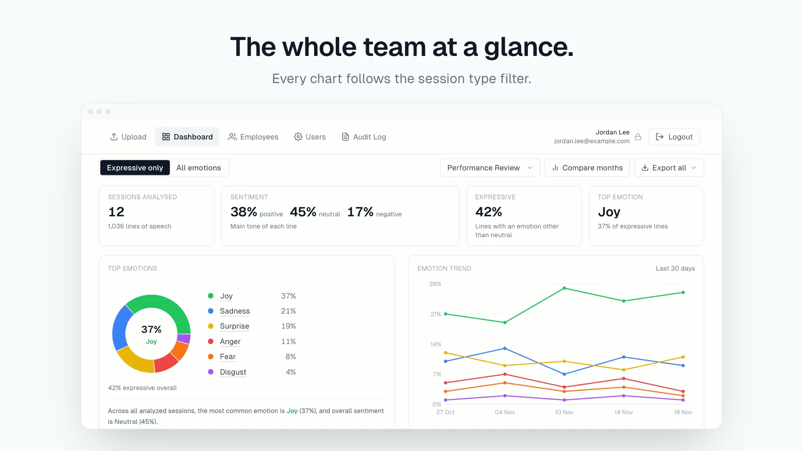

<div align="center">



# HR Sentiment Analysis

**Upload a recorded HR session. Every spoken line comes back with an emotion and a sentiment.**<br>
The model reads the face, the voice and the words together, not just the transcript.


</div>

---

This is our BS Computer Science thesis project, made by Kurt Denver Chavez, Aleck Christian Duran, Ed Martin Hibaler and Arcejay Enano. HR teams sit through a lot of recorded interviews, onboarding talks, trainings, performance reviews and meetings, and most of the reviewing is still done by watching the video and taking notes. We wanted a tool that does the first pass: who said what, how it was said, and where the tense moments are.

## What it does

- **Transcribes and splits by speaker.** Whisper writes the transcript, pyannote works out who is talking.
- **Labels every line.** One of 7 emotions (anger, disgust, fear, joy, neutral, sadness, surprise) and one of 3 sentiments (positive, neutral, negative), each with a confidence score.
- **Dashboard.** Sessions per type, the sentiment split, top emotions and a 30-day emotion trend. Managers can compare this month with last month.
- **Session page.** A short summary, high-emotion moments, and a transcript you can filter by speaker, emotion or sentiment. For meetings you link each speaker to an employee.
- **Reports.** A quarterly report for the HR Director, plus PDF and CSV exports.
- **Accounts.** Staff, Manager and Director roles, a 6-digit email code at login, remembered devices, and an audit log. Accounts and employees are archived, never deleted.

## How it works

```
 browser ──upload──▶ Cloudflare R2 ──▶ inference server (Python)
                                         │  ffmpeg cuts the audio and each line's clip
                                         │  Whisper → transcript with timestamps
                                         │  pyannote → speaker labels
                                         │  model → emotion + sentiment per line
                                         ▼
 dashboard ◀── SQLite ◀── Next.js app ◀── signed result (HMAC)
```

The video goes straight from the browser to R2, so the web app never holds the file. The inference server runs one job at a time, picks up unfinished jobs after a restart, and sends the result back signed so the app can tell it is genuine. The video is deleted from R2 once the result is saved.

## The model

The model code is not ours to claim. It comes from **Andreas Trolle's [ai-video-sentiment-model](https://github.com/Andreaswt/ai-video-sentiment-model)** (MIT), which he walks through in [this video](https://youtu.be/Myo5kizoSk0). We trained it ourselves on MELD and built the HR system around it.

Each line goes in as three inputs, and each becomes 128 numbers:

| Input | Encoder |
|---|---|
| Words | BERT (`bert-base-uncased`, frozen) |
| Video | R3D-18 on the line's first 30 frames |
| Voice | 1D CNN on a 64-band mel spectrogram |

The three are joined (384 numbers), passed through a shared layer, and two heads give the emotion and the sentiment.

**Results on the MELD test set (2,610 lines):**

| | Accuracy | Weighted F1 |
|---|---|---|
| Emotion (7 classes) | 50.92% | 54.02 |
| Sentiment (3 classes) | 66.78% | 67.06 |

Be aware of what it was trained on. MELD is dialogue from the TV show *Friends*, so it is lively and acted. Calm, formal HR speech often comes out as sadness, and fear and disgust are rare in the data, so treat those two labels as weak signals.

## Running it locally

You need Node.js 18.18 or newer, Python 3.12, ffmpeg, a [Hugging Face](https://huggingface.co) token that has accepted the `pyannote/speaker-diarization-3.1` and `pyannote/segmentation-3.0` terms, a Cloudflare R2 bucket, and an SMTP account for the login codes.

**1. Inference server** (from `ai-video-sentiment-model/deployment/`)

```bash
python3.12 -m venv venv
./venv/bin/pip install -r requirements.lock
# put HF_TOKEN, MODAL_TRIGGER_TOKEN, INFERENCE_CALLBACK_SECRET and CALLBACK_URL in .env
set -a; source .env; set +a
./venv/bin/python server.py        # listens on 127.0.0.1:8000
```

The trained weights (`model_normalized/model.pth`, 572 MB) are not in the repo.

**2. Web app** (from `ai-video-sentiment-web/`)

```bash
npm install
cp .env.example .env               # fill in the values
npm run db:push                    # creates prisma/db.sqlite
npx tsx scripts/create-admin.ts you@example.com "Your Name" "a-strong-password" MANAGER
npm run dev                        # http://localhost:3000
```

Set `MODAL_TRIGGER_URL=http://127.0.0.1:8000/trigger` so the app sends jobs to the local server. Use `npx next build --no-lint && npx next start` instead of `npm run dev` when other people will use it.

## Project layout

```
ai-video-sentiment-model/
  training/      training scripts and the MELD dataset loader
  deployment/    inference.py, models.py, server.py (local), modal_app.py (cloud backup)
ai-video-sentiment-web/
  src/app/       pages and API routes
  src/actions/   server actions (auth checks, validation)
  src/server/    services, repositories, R2 and mail clients
  prisma/        database schema
```

## Credits

- [Andreas Trolle](https://github.com/Andreaswt) for the multimodal model and its training code.
- [MELD](https://affective-meld.github.io) by Poria et al. (2019), the dataset the model learned from.
- [Whisper](https://github.com/openai/whisper) for transcription and [pyannote.audio](https://github.com/pyannote/pyannote-audio) for speaker diarization.
- The [T3 Stack](https://create.t3.gg) the web app is built on.

## License

MIT. The web app is ours (`ai-video-sentiment-web/LICENSE.MD`). The model folder keeps Andreas Trolle's copyright notice in `ai-video-sentiment-model/LICENSE.MD`, as the MIT license requires.
